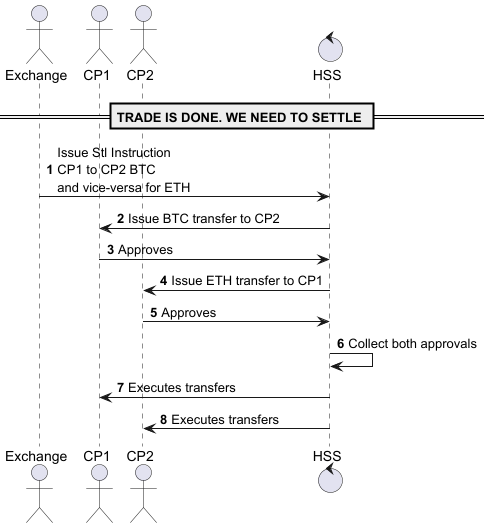

# Project Hephaestus: Programmatic Policy

A working example in TypeScript of a programmatic policy with groups and controls.  

Hephaestus is the God of the forge, craftsmanship, and technology: He built the gods' strongest weapons and armor. This name suggests a robust, well-crafted, and technologically superior security framework ;-)

Hephaestus allows the abstraction of underlying crypto custodians, while retaining control of the most crucial aspect of their platforms: the entitlement system.

## Data Model

```typescript
/**
 * Identifiable by id
 */
export interface Identifiable {
    id: string;
}

/**
 * An Organisation represents a corporation, which can, optionnally have sub-orgs via the topOrg property
 * It defines meta data, an optional Map of fields where properties such as location, jurisdiction, etc can be added
 */
export interface Organisation {
    topOrg?: Organisation;
    id: string;
    name: string;
    meta?: Map<string, string | number>;
    enabled: boolean;
}

/**
 * An Actor defines a Human Being or Computer (Service).
 * An Actor belongs to one Organisation
 * An Actor as a Role - a free text field, mandatory, defining roles such as MAKER, CHECKER, COMPLIANCE, etc
 */
export interface Actor extends Identifiable {
    id: string;
    name: string;
    role: string;
    orgId: string;
    meta?: Map<string, string | number>;
    publicKey?: string 
    enabled: boolean;
}

/**
 * A Policy is at the core of Authorisation of actions on the platform
 * When a Wish is submitted - an intent to perform an action - A Policy must be found for that Wish - otherwise it is rejected.
 * A Policy can apply top to bottom - Policy from the Top must first evaluate to true before the Policy on the Target Org.
 * subOrgApplicability to true allows to apply, for ex, Compliance services at the Top, followed by Transfer Out Policies on the Target Org.
 * A Policy applies to a Wish Kind and defines Rules - in an ordered list - first one is processed - if the rule does not evaluate - we go to the second one etc
 * When a Rule is selected, we need to apply Controls to that Rule - this is done using Controls - there is a mapping between a Rule Id and a Control Id
 */
export interface Policy {
    id: string;
    name: string;
    orgId: string;
    subOrgApplicability: boolean;
    wishKind: string;
    ruleIds: string[];
    controls: Map<string, string>;
    enabled: boolean;
    dynamic?: boolean;
    createdAt?: number;
    validFor?: number;
}

/**
 * A Policy Rule defines an optional JavaScript based expression, when evaluated to true, will be selected
 */
export interface PolicyRule {
    id: string;
    name: string;
    expression?: string;
    enabled: boolean;
}

/**
 * Part of the Policy Control is the Control Config to apply
 * A Control config defines the Roles and The Organisations needed for an approval of the Policy
 * It defines a minimum of approvers - the quorum required to approve
 * If a Role is set to CHECKER and there are two Actors associated with CHECKER, both will be notified for approval
 * If minApprover is set to 1, as long one approves, it is considered successful. If anyone rejects, it is rejected
 */
export interface PolicyControlConfig {
    roles: string[];
    orgs: string[];
    minApprover: number;
    timeoutInSeconds: number;
}

/**
 * The Control itself is a Directed Acycliv Graph with Operands, allowing the complex definition of approval schemes
 * If there is no config, operand, left and right must be defined
 * If there is a config, operand, left and right must be null
 */
export interface PolicyControl {
    id: string;
    name: string;
    config?: PolicyControlConfig;
    operand?: string;
    left?: PolicyControl;
    right?: PolicyControl;
} 

/**
 * This will defined the JSON structure on which expressions will be evaluated
 */
export interface OrgStructure {
    orgs: Map<string, Organisation>;
    actors: Map<string, Actor>;
    policies: Map<string, Policy>;
    rules: Map<string, PolicyRule>;
    controls: Map<string, PolicyControl>;
    wish?: Wish;
    wallets?: Map<String, Wallet>;
}

/**
 * A Wish is an intent to perform an action
 * It is done by an Actor (The Maker role) and targets a given Organisation
 * It has a kind (some are pre-defined 'WISH_CREATION', 'TRANSFER_OUT', ....) but they can be generic 
 * In the generic version, this is basically an Policy engine for any custom action
 */
export interface Wish {
    id: string;
    actorId: string;
    tgtOrgId: string;
    kind: string;
    meta?: Map<string, string | number>;
    payload: any;
}

/**
 * Wallet
 */
export interface Wallet {
    id: string;
    orgId: string;
    name: string;
    chain: string;
    provider?: string;
    meta?: Map<string, string | number>;
}

/**
 * Transfer Out Payload
 */
export interface TransferOutPayload {
    fromWallet: string;
    toAddress: string;
    amount: string;
    meta?: Map<string, string | number>;
}

export interface CreateWalletPayload {
    name: string;
    chain: string;
    meta?: Map<string, string | number>;
    provider?: string; // DFNS or THALES
}
```

## Basic Implementation of a Wish creation for a Transfer Out
- A Wish is an Intent
- Shows programmatic expression for Wish Creation as well as Transfer Out Amount

```typescript
import "../model/model"

let corp: Organisation = {id: "SC1", name:"SuperCorp", enabled:true}

let tj: Actor = {id: "TJ", name: "Thierry", role: "MAKER", orgId: "SC1", enabled: true}
let cj: Actor = {id: "CJ", name: "Claire", role: "CHECKER", orgId: "SC1", enabled: true}
let co: Actor = {id: "CO", name: "CO", role: "COMPLIANCE_OPS", orgId: "SC1", enabled: true}
let wls: Actor = {id: "WLS", name: "WHITELIST SERVICE", role: "WL_SERVICE", orgId: "SC1", enabled: true}
let kyts: Actor = {id: "KYT", name: "KYT SERVICE", role: "KYT_SERVICE", orgId: "SC1", enabled: true}

// DEFAULT CONTROL
let defaultControl: PolicyControl = {id: "DFCTRL", name: "DFCTRL"}

// WISH CREATION
let wishCreationPolicyRule: PolicyRule = {
    id: "WPR-1", name: "Wish Creation Rule", priority:0, expression: "ctx.actors[ctx.wish.actorId].orgId === ctx.wish.tgtOrgId && ctx.actors[ctx.wish.actorId].role === 'MAKER'"}
let wishCreationPolicy: Policy = {
    id: "WP-1", name: "With Creation Policy", orgId: corp.id, subOrgApplicability: false, wishKind: "WISH_CREATION", 
    ruleIds: [wishCreationPolicyRule.id], enabled: true, validFor: Number.MAX_VALUE}

// TRANSFER OUT
// CHECKER AND (WL_SERVICE OR COMPLIANCE_OFFICER) AND (KYT_SERVICE OR COMPLIANCE_OFFICER)
let checkerCtrlCfg: PolicyControlConfig = {roles: ["CHECKER"], orgs: ["SC1"], minApprover: 1, timeoutInSeconds: 3600}
let wlsCtrlCfg: PolicyControlConfig = {roles: ["WL_SERVICE"], orgs: ["SC1"], minApprover: 1, timeoutInSeconds: 3600}
let kytCtrlCfg: PolicyControlConfig = {roles: ["KYT_SERVICE"], orgs: ["SC1"], minApprover: 1, timeoutInSeconds: 3600}
let coCtrlCfg: PolicyControlConfig = {roles: ["COMPLIANCE_OPS"], orgs: ["SC1"], minApprover: 1, timeoutInSeconds: 3600}

let kytPolCtrl: PolicyControl = {id: "KYT_CTRL-1", name: "KYT_CTRL", config: kytCtrlCfg}
let coPolCtrl: PolicyControl = {id: "CO_CTRL-1", name:"CO_CTRL", config: coCtrlCfg}
let kytCtrlGrp: PolicyControl = {id: "KYT_CTRL-GRP-1", name: "KYT_CTRL_GROUP", operand: "OR", left: kytPolCtrl, right: coPolCtrl}
console.log("KYT CONTROL GROUP", kytCtrlGrp)

let wlsPolCtrl: PolicyControl = {id: "WLS_CTRL-1", name: "WLS_CTRL", config: wlsCtrlCfg}
let wlsCtrlGrp: PolicyControl = {id: "WLS_CTRL-GRP-1", name: "WLS_CTRL_GROUP", operand: "OR", left: wlsPolCtrl, right: coPolCtrl}

let complianceCtrlGrp: PolicyControl = {id: "COMPLIANCE_CTRL-GRP-1", name: "COMPLIANCE_CTRL_GROUP", operand: "AND", left: kytCtrlGrp, right: wlsCtrlGrp}

let checkerPolCtrl: PolicyControl = {id: "CHECKER_CTRL-1", name: "CHECKER_CTRL", config: checkerCtrlCfg}
let transferOutPolCtrl: PolicyControl = {id: "TFOUT-CTRL-1", name: "TFOUT CONTROL", operand: "AND", left: checkerPolCtrl, right: complianceCtrlGrp}

let tftOutPolicyRule: PolicyRule = {
    id: "TFTO-1", name: "Transfer Out Rule", priority:0, controlId: transferOutPolCtrl.id, expression: "Number(ctx.wish.payload.amount) > 5000"}
let tftOutPolicy: Policy = {
    id: "TFTO-POL-1", name: "Transfer Out Policy", orgId: corp.id, subOrgApplicability: false, wishKind: "TRANSFER_OUT", 
    ruleIds: [tftOutPolicyRule.id], enabled: true, validFor: Number.MAX_VALUE}
//

const actorsMap = [tj, cj, co, wls, kyts].reduce((map, actor) => {
        map.set(actor.id, actor);
        return map;
      }, new Map<string, Actor>());
console.log("Actors Map:", actorsMap);

const policiesMap = [wishCreationPolicy, tftOutPolicy].reduce((map, policy) => {
    map.set(policy.id, policy);
    return map;
  }, new Map<string, Policy>());
console.log("Policies Map:", policiesMap);
      
const rulesMap = [wishCreationPolicyRule, tftOutPolicyRule].reduce((map, rule) => {
    map.set(rule.id, rule);
    return map;
  }, new Map<string, PolicyRule>());

  const controlsMap = [defaultControl, transferOutPolCtrl].reduce((map, control) => {
    map.set(control.id, control);
    return map;
  }, new Map<string, PolicyControl>());

let structure: OrgStructure = {
    org: corp, actors: actorsMap, policies: policiesMap, rules: rulesMap, controls: controlsMap} 

class PolicyEngine {
    private _structure: OrgStructure;

    constructor(_structure: OrgStructure) {
        this._structure = _structure;
    }   

    process(wish: Wish): void {
        this._structure.wish = wish
        console.log("Structure:", this._structure)

        // Is Wish Creation Allowed?
        if (!this.isWishCreationAllowed(wish)) {
            return;
        }

        // Find Policy for Wish Kind
        const selectedPolicies: Policy[] = [...this._structure.policies.values()].map(p => p).filter(p =>  
            p.orgId === wish.tgtOrgId && p.enabled && p.wishKind === wish.kind)
        const selectedPolicy: Policy = selectedPolicies[0]
        const ruleId: string = selectedPolicy.ruleIds[0]
        const selectedRule: PolicyRule = [...this._structure.rules.values()].map(r => r).filter(r => r.id === ruleId)[0]
        console.log("Selected Rule For Wish Kind: ", selectedRule);
        if (selectedRule.expression) {
            const outcome = this.evaluate(selectedRule.expression)
            console.log("[WISH KIND] Rule's evaluation:", outcome);
        }

        // TODO: Get Controls from the Rule and execute them.
        // Once the controls have been successfully executed, execute the transfer out
    }

    isWishCreationAllowed(wish: Wish): boolean {
        const selectedPolicies: Policy[] = [...this._structure.policies.values()].map(p => p).filter(p =>  
            p.orgId === wish.tgtOrgId && p.enabled && p.wishKind === "WISH_CREATION")
        console.log("Selected Policies For Wish Creation: ", selectedPolicies);
        const selectedPolicy: Policy = selectedPolicies[0]
        console.log("Selected Policy For Wish Creation: ", selectedPolicy);
        const ruleId: string = selectedPolicy.ruleIds[0]
        const selectedRule: PolicyRule = [...this._structure.rules.values()].map(r => r).filter(r => r.id === ruleId)[0]
        console.log("Selected Rule For Wish Creation: ", selectedRule);

        if (selectedRule.expression) {
            const outcome = this.evaluate(selectedRule.expression)
            if (outcome) {
                console.log("[WISH CREATION] Rule's evaluation is true, using it!", selectedRule.id);
                return true;
            } else {
                console.log("[WISH CREATION] Rule's evaluation failed!");
                return false;
            }
        } else {
            console.log("[WISH CREATION] No expression in rule, using it!", selectedRule.id);
            return true;
        }
    }

    map2json(key:string, value:any) {
        if(value instanceof Map) {
            const jsonObject = Object.fromEntries(value);
            // const jsonString = JSON.stringify(jsonObject);
            return jsonObject;
        } else {
            return value;
        }
    }

    evaluate(expression: string): boolean {
        console.log("Structure before jsonification: ", this._structure);
        const structJson = JSON.stringify(this._structure, this.map2json)
        console.log("Evaluating expression on structure: ", structJson);

        const expr = 
        `
            const ctx = ${structJson}; 
            ${expression}
        `;

        return eval(expr)
    }
}


let transferOutPayload: TransferOutPayload = {fromWallet: "TJ-WALLET-ID-1", toAddress: "0x123", amount: "5001"}
let tftOutWish: Wish = {id: "TFTO-1", actorId : tj.id, tgtOrgId: corp.id, kind: "TRANSFER_OUT", payload: transferOutPayload}

let pe: PolicyEngine = new PolicyEngine(structure)
pe.process(tftOutWish)
```

## JSON Structure of the Organisation 

```json
{
    "orgs": {
        "SC1": {
            "id": "SC1",
            "name": "SuperCorp",
            "enabled": true
        }
    },
    "actors": {
        "TJ": {
            "id": "TJ",
            "name": "Thierry",
            "role": "MAKER",
            "orgId": "SC1",
            "enabled": true
        },
        "CJ": {
            "id": "CJ",
            "name": "Claire",
            "role": "CHECKER",
            "orgId": "SC1",
            "enabled": true
        },
        "CO": {
            "id": "CO",
            "name": "CO",
            "role": "COMPLIANCE_OPS",
            "orgId": "SC1",
            "enabled": true
        },
        "WLS": {
            "id": "WLS",
            "name": "WHITELIST SERVICE",
            "role": "WL_SERVICE",
            "orgId": "SC1",
            "enabled": true
        },
        "KYT": {
            "id": "KYT",
            "name": "KYT SERVICE",
            "role": "KYT_SERVICE",
            "orgId": "SC1",
            "enabled": true
        }
    },
    "policies": {
        "WP-1": {
            "id": "WP-1",
            "name": "Wish Creation Policy",
            "orgId": "SC1",
            "subOrgApplicability": false,
            "wishKind": "WISH_CREATION",
            "ruleIds": [
                "WPR-1"
            ],
            "controls": {},
            "enabled": true,
            "validFor": 1.7976931348623157e+308
        },
        "TFTO-POL-1": {
            "id": "TFTO-POL-1",
            "name": "Transfer Out Policy",
            "orgId": "SC1",
            "subOrgApplicability": false,
            "wishKind": "TRANSFER_OUT",
            "ruleIds": [
                "TFTO-1"
            ],
            "controls": {
                "TFTO-1": "TFOUT-CTRL-1"
            },
            "enabled": true,
            "validFor": 1.7976931348623157e+308
        }
    },
    "rules": {
        "WPR-1": {
            "id": "WPR-1",
            "name": "Wish Creation Rule",
            "enabled": true,
            "expression": "ctx.actors[ctx.wish.actorId].orgId === ctx.wish.tgtOrgId && ctx.actors[ctx.wish.actorId].role === 'MAKER'"
        },
        "TFTO-1": {
            "id": "TFTO-1",
            "name": "Transfer Out Rule",
            "expression": "Number(ctx.wish.payload.amount) > 5000",
            "enabled": true
        }
    },
    "controls": {
        "DFCTRL": {
            "id": "DFCTRL",
            "name": "DFCTRL"
        },
        "TFOUT-CTRL-1": {
            "id": "TFOUT-CTRL-1",
            "name": "TFOUT CONTROL",
            "operand": "AND",
            "left": {
                "id": "CHECKER_CTRL-1",
                "name": "CHECKER_CTRL",
                "config": {
                    "roles": [
                        "CHECKER"
                    ],
                    "orgs": [
                        "SC1"
                    ],
                    "minApprover": 1,
                    "timeoutInSeconds": 3600
                }
            },
            "right": {
                "id": "COMPLIANCE_CTRL-GRP-1",
                "name": "COMPLIANCE_CTRL_GROUP",
                "operand": "AND",
                "left": {
                    "id": "KYT_CTRL-GRP-1",
                    "name": "KYT_CTRL_GROUP",
                    "operand": "OR",
                    "left": {
                        "id": "KYT_CTRL-1",
                        "name": "KYT_CTRL",
                        "config": {
                            "roles": [
                                "KYT_SERVICE"
                            ],
                            "orgs": [
                                "SC1"
                            ],
                            "minApprover": 1,
                            "timeoutInSeconds": 3600
                        }
                    },
                    "right": {
                        "id": "CO_CTRL-1",
                        "name": "CO_CTRL",
                        "config": {
                            "roles": [
                                "COMPLIANCE_OPS"
                            ],
                            "orgs": [
                                "SC1"
                            ],
                            "minApprover": 1,
                            "timeoutInSeconds": 3600
                        }
                    }
                },
                "right": {
                    "id": "WLS_CTRL-GRP-1",
                    "name": "WLS_CTRL_GROUP",
                    "operand": "OR",
                    "left": {
                        "id": "WLS_CTRL-1",
                        "name": "WLS_CTRL",
                        "config": {
                            "roles": [
                                "WL_SERVICE"
                            ],
                            "orgs": [
                                "SC1"
                            ],
                            "minApprover": 1,
                            "timeoutInSeconds": 3600
                        }
                    },
                    "right": {
                        "id": "CO_CTRL-1",
                        "name": "CO_CTRL",
                        "config": {
                            "roles": [
                                "COMPLIANCE_OPS"
                            ],
                            "orgs": [
                                "SC1"
                            ],
                            "minApprover": 1,
                            "timeoutInSeconds": 3600
                        }
                    }
                }
            }
        }
    },
    "wallets": {
        "MyBTCWallet": {
            "id": "MyBTCWallet",
            "orgId": "SC1",
            "name": "BTC Trading Wallet",
            "chain": "TESTNET"
        }
    },
    "wish": {
        "id": "TFTO-1",
        "actorId": "TJ",
        "tgtOrgId": "SC1",
        "kind": "TRANSFER_OUT",
        "payload": {
            "fromWallet": "MyBTCWallet",
            "toAddress": "0x123",
            "amount": "5001"
        }
    }
}
```

# Use Cases

##  Use Case 1: Basic Demo of a Wish Creation & Transfer Out Policies from a Single Organisation
See [UseCase-1.ts](./src/investigations/demo/UseCase-1.ts)

##  Use Case 2: A Settlement Wallet Controlled by an Exchange and a Customer for Settlement Purposes
See [UseCase-2.ts](./src/investigations/demo/UseCase-2.ts)

##  Use Case 3: Wallet Creation for DFNS (MPC) or THALES (HSM)
See [UseCase-3.ts](./src/investigations/demo/UseCase-3.ts)

##  Use Case 4: A Settlement Wallet Controlled by an Exchange and a Customer for Settlement Purposes Using PolicyControlConfig
See [UseCase-4.ts](./src/investigations/demo/UseCase-4.ts)

##  Use Case 5: Dynamic Policy for Escrow
The only difference here is that the [Policy Engine](./src/Hephaestus/pe/HephaestusPolicyEngine.ts) will first check if there is a dynamic policy to check first.
Dynamic Policies take precendance over everything else.

## Use Case 6: Hierarchical Policies
The only difference here is that the [Policy Engine](./src/Hephaestus/pe/HephaestusPolicyEngine.ts) will first check for all Policies top-down

## Database
- Most of the data stored will be JSON based
- Org, Actor, Policy, Rule, Control, Config, Wish, Wallets, Transactions
- Whereever applicable, JSONs are signed by the application
- A bootstrap is required - See OrgStructure
- An Org structure has a version

## Bootstrap
In order to bootstrap the app, we must have at minimum:
- An org def
- Actors
- Policies to create new policies

# Notes on Settlement
Hephaestus provides the basic layer to abstract all crypto providers.  
Hephaestus via its data model provides a common representation of a wallet address and a common way to interact with such a 
wallet.  
Typical settlement services are centralised (Clearing house a la Clear Token, or Clear Loop), other models rely on 
a specific Custodian implementation (a la Interchange, or a la Fireblocks).
There is no model that is actually "decentralised", open, custodian-tech provider agnostic.

Enters Hephaestus Settlement Service (HSS).

## HSS
With HSS, we can define an abstract layer on top of existing custodians and crypto-providers with a normalised
representation of a wallet and its control.  
[UseCase 4](./src/investigations/demo/UseCase-4.ts) demonstrates how a Wallet can have dual control from two different entities.  
Dual control is required over settlement to ensure that assets are moved if and only if both parties involved in a trade
say yes to the transfer of the underlying asset.  
However, this is only one leg of a trade and is not an atomic settlement (only possible on the same chain - ignoring
complexities of cross-chain transfers).  

How to solve for the classic BTC/ETH transaction settlement? (Counter party 1, CP1, transfers BTC to CP2 and CP2 ETH to CP1).  

We have the following:
- CP1 owns BTC wallet Wb1 and ETH wallet We1
- CP2 owns Wb2 and We2
- On a BTC/ETH trade, CP1 transfers from Wb1 to Wb2 and CP2 transfers from We2 to We1
    - Wb1 -> Wb2: BTC transferred - this is Tx1
    - We2 -> We1: ETH transferred - this is Tx2

We assume that an exchange will act as an initiator for both transactions.
Both transactions must be fully approved by all parties involved and only be propagated to the underlying providers
if and only if full approval has been executed.

HSS will collect both approvals before sending the authorisation to the underlying providers.

The exchange - in this example is where the trade happened - will send a cryptographically signed message to HSS.  
Upon reception of this message, HSS will issue a transfer out call to both wallets - and will only propagate the calls
only if both transfers are fully approved.  
This exchange call is a specific endpoint tailored for two transfers.



HSS can be configured by exchange, counter-parties