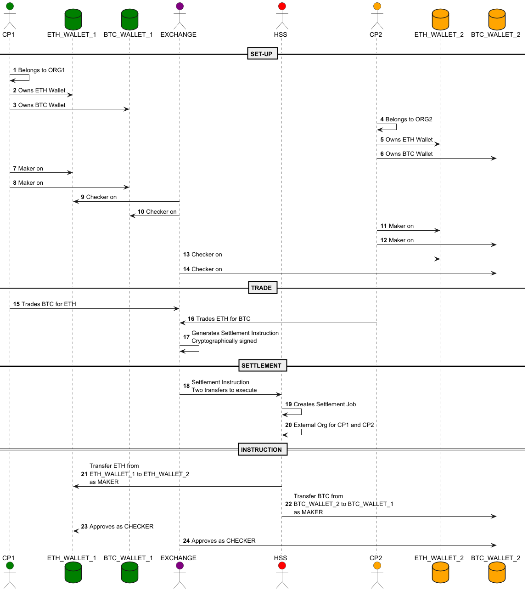

# Settlement

A fairly complex use case for exchanges, custodians to handle is cross-chain atomic settlement. 

This is the set up required for this demo:

- Create 2 Hephaestus Wallets, ideally two providers, but at least two different crypto-currencies
- Simulate an off-chain trade via an exchange - with the settlement details cryptographically signed by the exchange
- Exchange sends the trade details to a dedicated Hephaestus Settlement Service (HSS)
- HSS will act as a maker for both counterparties

## CPs

### ORG 1
- ORG1, MAKER_ORG1, CHECKER_ORG1
- ETH WALLET 1:
- BTC WALLET 1:

### ORG 2
- ORG2, MAKER_ORG2, CHECKER_ORG2
- ETH WALLET 2:
- BTC WALLET 2: 

### EXCHANGE
- No wallet
- Onboarded via KPI

### HSS
- HSS, MAKER_HSS, CHECKER_HSS
- No wallet

## Concept
- The HSS receives a Settlement Instruction by the Exchange.
- (Exchange is onboarded and its public key associated with it for the verification).
- There is a Settlement Wallet - Meta Data = TYPE = SETTLEMENT
- One Settlement Wallet per Exchange
- The Echange is a checker to approve withdraws from a Settlement wallet on both wallets
- The maker to settle is the HSS -- this avoids the Exchange to be maker on both wallets.

## Flows


# Hephaestus Set-Up
- 3 orgs in Hephaestus.organization (ORG1, ORG2, EXCHANGE, HSS)
- ORG1 has  MAKER_ORG1, CHECKER_ORG1
- ORG1 has  MAKER_ORG2, CHECKER_ORG2
- ORG1 has 2 settlements wallets: ETH and BTC
- ORG2 has 2 settlements wallets: ETH and BTC
- HSS can send a wish to ORG1 & ORG2 only on the settlement wallets as a MAKER
- EXCHANGE says YES as a CHECKER 

See [bootstrap](./src/Hephaestus/bootstrap/CreateBootstrap4StlUseCase.ts)

## Wishes

### ORG wish can be created by any maker in ORG:

```text
"
ctx.actors[ctx.wish.actorId].orgId === ctx.wish.tgtOrgId && ctx.actors[ctx.wish.actorId].role === 'MAKER'
"
```

### EXC can create a wish only for transfer out on settlement wallets as checker:

```text
"
ctx.actors[ctx.wish.actorId].orgId === 'EXC' &&
ctx.wish.tgtOrgId === 'ORG1' &&
ctx.wish.kind === 'TRANSFER_OUT' &&
ctx.wallets[ctx.wish.payload.fromWallet].meta['TYPE'] === 'SETTLEMENT' &&
ctx.actors[ctx.wish.actorId].role === 'CHECKER'
"
```

### HSS can create wishes for transfer out on settlement wallets only as makers within ORG

```text
"
ctx.actors[ctx.wish.actorId].orgId === 'HSS' &&
ctx.wish.tgtOrgId === 'ORG1' &&
ctx.wish.kind === 'TRANSFER_OUT' &&
ctx.wallets[ctx.wish.payload.fromWallet].meta['TYPE'] === 'SETTLEMENT' &&
ctx.actors[ctx.wish.actorId].role === 'MAKER'
"
```

## Boostrap

See [CreateBootstrap4StlUseCase](./src/Hephaestus/bootstrap/CreateBootstrap4StlUseCase.ts)

```shell
npx ts-node .\src\Hephaestus\pe\HephaestusService.ts
npx ts-node .\src\Hephaestus\user\HephaestusCalls.ts  
npx ts-node .\src\Hephaestus\plugins\dfns\DfnsServiceProvider.ts
npx ts-node .\src\Hephaestus\pe\HephaestusJobs.ts 
npx ts-node .\src\Hephaestus\bootstrap\CreateBootstrap4StlUseCase.ts
```

## Post Bootstrap

### Create Wallet Creation Policy Programmatically (ORG1 & ORG2)
See [HephaestusCallsCreateWalletPolicy](./src/Hephaestus/user/HephaestusCallsCreateWalletPolicy.ts).  
See [HephaestusCallsCreateWallet](./src/Hephaestus/user/HephaestusCallsCreateWallet.ts).  

```typescript
const createWalletPolicyPayload = {
    "id":genId("org1-wallet-pol"),"name":"Create Wallet Policy",
    "orgId":"ORG1","subOrgApplicability":false,
    "wishKind":"CREATE_WALLET",
    "ruleIds":["org1-create-pol-248231a6ddec7d12"],"controls":{"org1-create-pol-248231a6ddec7d12":"org1-create-pol-ctrl-b646810fdab5d1ba"},
    "enabled":true,"dynamic":false,"validFor":1.7976931348623157e+308}
const createWalletPolicyWish = {id: genId("org1-wish-pol-create"), actorId : "MAKER_ORG1", tgtOrgId: "ORG1", kind: "CREATE_POLICY", payload: createWalletPolicyPayload}
let result = post('http://localhost:4000/create-wish', createWalletPolicyWish)
```

### Create Wallet Programmatically (ORG1 & ORG2)

```typescript
const createWalletPayload = {name: "EthStlWallet0", chain: "EthereumSepolia", provider: "DFNS"}
const createWalletWish = {id: genId("WISH-wc"), actorId : "MAKER_ORG1", tgtOrgId: "ORG1", kind: "CREATE_WALLET", payload: createWalletPayload}
let result = post('http://localhost:4000/create-wish', createWalletWish)
```

### Create Wallet Settlement Policies (ORG1 & ORG2)
For settlement purposes, we need transfer out policies for both ORG1 and ORG2.  
HSS is the MAKER for both and EXC the CHECKER for both.  
Only on wallets of type SETTLEMENT.

We just need a new policy using the same rule ("hss-wish-rule-org...) as the wish:

```json
ctx.actors[ctx.wish.actorId].orgId === 'HSS' &&
ctx.wish.tgtOrgId === 'ORG1' &&
ctx.wish.kind === 'TRANSFER_OUT' &&
ctx.wallets[ctx.wish.payload.fromWallet].meta['TYPE'] === 'SETTLEMENT' &&
ctx.actors[ctx.wish.actorId].role === 'MAKER'
```

As for the control, the checker is on EXC

See [HephaestusCallsCreateStlTftPolicy](./src/Hephaestus/user/HephaestusCallsCreateStlTftPolicy.ts)

## Settlement Process
Using all of the above, create a settlement instuction using [ExchangeCall](./src/Hephaestus/user/ExchangeCall.ts):

- Wallet 1:
    - ETH-WALLET-0(EthereumSepolia), wa-1ol09-a00l3-9e1p9meafj5q609u, 0x4c762342bdd28fefe37cedacbc6ca04161689fed
- Wallet 2: 
    - ETH-WALLET-1(EthereumSepolia), wa-5jqk8-vnome-8m1rj7pe01hffng1, 0x8c182d6c273802081f1afc511a752167d318c3f7

ExchangeCall creates a Settlement Instruction which is sent to the [HephaestusService](./src/Hephaestus/pe/HephaestusService.ts). 
Then, [](./src/Hephaestus/pe/HephaestusSettlementJobs.ts) picks up the instructions, runs them for approval via [HephaestusService](./src/Hephaestus/pe/HephaestusService.ts)
and [HephaestusPolicyEngine](./src/Hephaestus/pe/HephaestusPolicyEngine.ts) and inserts the signed instructions in the table Hephaestus.settlement.

# TODOs

- Handle native transfers and wallet to wallet transfers
- Implement cryptographic sigs
