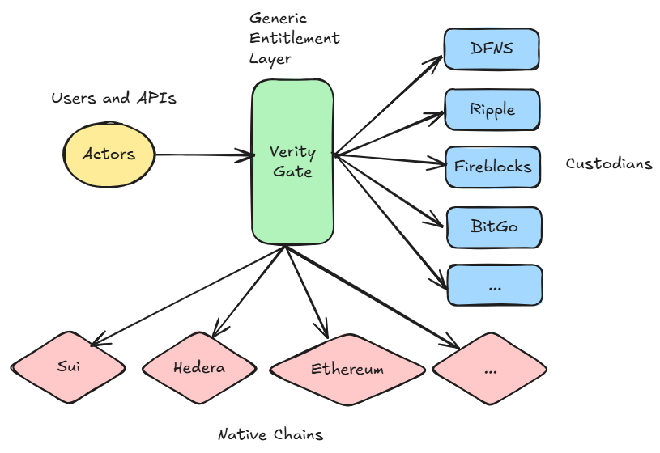

# VerityGate

## Intro

VerityGate is a generic entitlement layer for crypto providers, digital assets providers, including banks but also service providers.

All digital assets providers (DFNS, Ripple Custody, BitGo, Anchorage, ..) are based on three services:

- Ability to build native blockchain transactions, propagate them and index them,
- Ability to secure private keys (via MPC, HSMs),
- Finally, the only differentiator, provide a secure authorisation layer which is propriatary.

VerityGate addresses the last point. Provide a generic, flexible entitlement layer that allows the abstraction of the underlying providers, with the ability to handle rich and complex use cases for transfers, settlements, escrow, virtual accounts, exchange asset mirroring. 



### Dev Notes
I have decided to use [TypeScript](https://www.typescriptlang.org/) as a language for this project.
TypeScript offers flexibility, for ease of design and coding.
I have implemented this project in Python and Java, and settled for TypeScript. Way simpler.

```script
npm install -g typescript
tsc --version // Version 5.8.3
```

See this [tutorial](https://code.visualstudio.com/docs/typescript/typescript-tutorial).

Libs:
```script
npm install express
npm install --save-dev @types/express
npm install --save-dev @jest/globals @types/jest
```

## Data model

At the heart of VerityGate lies a data model.
Even though the data model is in TypeScript, ultimately, it serialises into JSON - and this will allow us to add programmability to the entitlement system. More on that later.

### Org

An **org** (or "domain", "organisation") represents the entity that has potentially sub-orgs. It is usually the legal owner of the wallets.

```typescript
export interface Org {
    topOrgId?: string;
    id: string;
    name: string;
    meta?: Map<string, string | number>;
    enabled: boolean;
}
```

### Actors

**Actors** belong to **orgs**. A given **actor** can only be part of a unique **org**. It also has a *role*. We will see that VerityGate allows complex cross-**orgs** policies.  
This design is clean and does not require the injection of **actors** in third-party **orgs** to handle complex use cases.

```typescript
export interface Identifiable {
    id: string;
}

export interface Actor extends Identifiable {
    id: string;
    name: string;
    role: string;
    orgId: string;
    meta?: Map<string, string | number>;
    publicKey?: string;
    enabled: boolean;
}
```

### Wishes

A **wish** is an intent made by an **actor** targetting an **org**.  
A **wish** has a *kind* and a *payload* (transfer, wallet creation, settlement,...).
Read it as an **actor** saying: "I **wish** to perform a specific action on an **org**, please authorise it if there are **policies** in place".

**WishPayload** is the intent cryptographically signed by an **actor**.

```typescript
export interface Wish {
    id: string;
    actorId: string;
    tgtOrgId: string;
    kind: string;
    meta?: Map<string, string | number>;
    payload: any;
}

export interface WishPayload {
    wish: Wish;
    signature: string; // base64-encoded signature
}
```

### Policies

**Policies** apply to specific **wishes**. They can also be applied top-down (by setting *subOrgApplicability* to true, think of an **org** mandating policies for all other sub-**orgs**).  
A **policy** can also be *dynamic*, i.e., short-lived, to handle scenarios such as escrows.  
A **policy** defines **rules** and **controls** meaning that if a **policy** is found and a **rule** has fired, **controls** will need to be applied.

```typescript
export interface Policy {
    id: string;
    name: string;
    orgId: string;
    subOrgApplicability: boolean;
    wishKind: string;
    ruleIds: string[];
    controls: Map<string, string>;
    enabled: boolean;
    dynamic?: boolean;
    createdAt?: number;
    validFor?: number;
}
```

### Rules

A **rule** must evaluate to true (or exist) for a **policy** to be applied.
If no *expression* is provided, it is always true, if not the *expression* is evaluated at runtime (this is the notion of programmatic rules).  
An entire context is given to the **policy** engine for the *expression* to be evaluated.

```typescript
export interface PolicyRule {
    id: string;
    name: string;
    expression?: string;
    enabled: boolean;
}
```

### Controls

Once a **rule** has been found and evaluated to true, its **controls** must be executed. A **policy control** is can be fairly complex and is implemented as a Directed Acyclic Graph.

The definition of *roles* and *orgs* at this level allows complex use cases where **actors** from mutliple **org** can participate in the **wish** approval.

A typical scenario is a settlement wallet, owned by a customer under the control of an exchange, where assets are mirrored for trading.

```typescript
export interface PolicyControl extends Identifiable {
  id: string;
  name: string;
  roles: string[];
  orgs: string[];
  minApprovers: number[];
  condition?: string;
  timeoutInSeconds: number;
}
```

### Wallets

A **wallet** is the virtual representation of the digital assets on-chain.
It belongs to an **org** and can have multiple *providers* (DFNS, Ripple Custody, Fireblocks, ...)

```typescript
export interface Wallet extends Identifiable {
    id: string;
    orgId: string;
    name: string;
    chain: string;
    provider?: string;
    meta?: Map<string, string | number>;
}
```

### Payloads

Now let's look at the digital assets payloads:

#### Wallet Creation Payload

A typical wallet creation payload:

```typescript
export interface CreateWalletPayload {
    name: string;
    chain: string;
    meta?: Map<string, string | number>;
    provider?: string;
}
```

### Transfer Out Payload

```typescript
export interface TransferOutPayload {
    fromWallet: string;
    toWallet: string;
    amount: string;
    meta?: Map<string, string | number>;
}
```

## Summary

An **org** has **actors** who submit **wishes** for approvals.  
A **policy** matches a **wish** and once a **rule** has been triggered, a set of **controls** are execute to authorise or deny the **wish**.  
**Orgs** can have sub-**orgs** and **policies** can be applied top-down.  
**Policies** can also be dynamic and have a TTL.

## Bootstrap

Bootstrapping is a critical part of how an **org** is set-up.  
Typically, an initial set-up creates default **actors** that have the ability to add/remove **actors** from the platform, but also define **policies**.  
Each **org** will have procedures in place in order to define group of **actors**, and what they are able to do, and the quorum required to approve **wishes**.  

This can become very complex to handle: let's assume the bear minimum:

- An **org**
- Two onboarded **actors** - a  **wish** creator and **wish** approver.
- A generic **policy** allowing the creation of **policies**

The idea is that with this minimal set-up, **actors** can created **policies** to add **actors** to the platform, create wallets, issue transfers, etc.

In production I would expect to have some **policies** pre-defined to ease onboarding.

Let's go through a simple intellectual exercise with this minimum set-up for **actors** to be able to create a wallet. We will then see the payloads involved.

Please note that each **actor** in our set-up would use [ECDSA](https://fr.wikipedia.org/wiki/Elliptic_curve_digital_signature_algorithm) - other methods will be added such as [WebAuthn](https://en.wikipedia.org/wiki/WebAuthn).

### A Simple Walktrhough

See [walkthrough.ts](./src/educ/walkthrough.ts).
With a minimum set-up, give the ability to create wallets.

#### Bootstrap

- An **org**
- Two onboarded **actors** - a  **wish** creator and **wish** approver.
- A generic **policy** allowing the creation of **policies**

Org:

```json
{
  "id": "org1",
  "name": "My Organization",
  "enabled": true
}
```

Actors:

```json
{
  "id": "alice",
  "name": "Alice",
  "role": "Maker",
  "orgId": "org1",
  "enabled": true
}
{
  "id": "bob",
  "name": "Bob",
  "role": "Checker",
  "orgId": "org1",
  "enabled": true
}
```

Now the **policy**: We need a generic **policy** so that the default **actors** can (1) create a **policy** (and approve it) to (2) add a wallet creation **policy**, what will allow the creation of a wallet!

Let's start with the **wish** to understand what is required:

```json
{
  "id": "create-wallet-policy-wish",
  "actorId": "alice",
  "tgtOrgId": "org1",
  "kind": "WALLET_CREATION_KIND",
  "payload": {
    "name": "My BTC Wallet",
    "chain": "BTC-MAIN-NET"
  }
}
```

We need to have a **policy** that allows the creation of a "create wallet" **policy** of kind 'WALLET_CREATION'.

For this we need to work backward: from the **controls** to the **rules** to the **policy** itself.

The following control says that we just need one approver from 'org1' with the role of 'Checker':

```json
{
  "id": "create-policy-control-id-1",
  "name": "Create Policy Control",
  "config": {
    "roles": [
      "Checker"
    ],
    "orgs": [
      "org1"
    ],
    "minApprover": 1,
    "timeoutInSeconds": 300
  }
}
```

A simple **rule** that always evaluate to true:

```json
{
  "id": "create-policy-rule-id-1",
  "name": "Create Policy Rule",
  "enabled": true
}
```

And finally the **policy** to create **policies**:

```json
{
    "id": "create-policy-id-1",
    "name": "Create Policy",
    "orgId": "org1",
    "subOrgApplicability": false,
    "wishKind": "CREATE_POLICY_KIND",
    "ruleIds": [
        "create-policy-rule-id-1"
    ],
    "controls": [
        [
            "create-policy-rule-id-1",
            "create-policy-control-id-1"
        ]
    ],
    "enabled": true,
    "dynamic": false,
    "createdAt": 1751552157087
}
```

- Alice will submit a **wish** of *kind* 'CREATE_POLICY_KIND' with a payload of *CreatePolicyPayload* with a *wishKind* of 'WALLET_CREATION_KIND'
- The system finds a **policy** of *kind* 'CREATE_POLICY_KIND'
- The system finds a **rule** id 'create-policy-rule-id-1'
- Then system enforces the **control** id 'create-policy-control-id-1' which specifies that an **actor** of role *Checker* from *org1* must approve the **wish**
- The system then creates a **policy** of type 'WALLET_CREATION_KIND' which will allow Alice to submit a new **wish** to create a wallet via the type 'WALLET_CREATION_KIND'

A closer look at *CreatePolicyPayload*:

```typescript
export interface CreatePolicyPayload {
    name: string;
    orgId: string;
    subOrgApplicability: boolean;
    wishKind: string;
    ruleIds: string[];
    controls: Map<string, string>;
    enabled: boolean;
    dynamic?: boolean;
    createdAt?: number;
    validFor?: number;
}
```

*CreatePolicyPayload* obviously contains data about which **rules** and **controls** to apply.  
Each **rule** and **control** creation also require a **policy**.

This is the gist of it. Note that even Wishes creation require 


We will now deep dive into the implementation, using various modules that can be changed (in-memory & database, ecdsa * webauthn, ..) and focus on interesing use cases...

### A note on rules programmability

It is impossible to define a generic entitlement framework without programmability.  
Some scenarios are just too complex to handle with this.

Internally, the [Policy Engine](./src/veritygate/VGPolicyEngine.ts) builds a context at runtime that matches the current [wish](./src/veritygate/VGPayloads.ts). This context is represented as a JSON document. When a **rule** is evaluated, there is an optional field called *expression*.  
If the field is present, the formula will be evaluated against the json context. If not present, the rule is considered to be true.

A typical formula can be:

```typescript
ctx.wish.payload.amount <= 100
```

applied on a [json context object](./src/educ/org-struct.json).

We will see more complex formulas with more complex use cases.

## Policy Engine Logic

The [Policy Engine](./src/veritygate/VGPolicyEngine.ts) logic defines how wishes are handled.  
The current implementation is a blueprint of what can be done. Feel free to modify the code and adapt it.

Here is the logic I implemented - along side some architectural decisions to make the implementation and operational aspect of the platform easy to deal with.  
Also in the current implementation, a single **policy** with a single **rule** is applied.

- A **wish** is submitted to the PE ("Policy Engine") - post authorisation of the **wish** digital signature
- A [JSON context object](./src/educ/org-struct.json) is built at runtime, providing a context for the rules to evaluate against
- The PE lists all the **policies** from the **top org** to the current targeted **org**
- In my logic, all top **policies** must pass before the ones below are applied
- For each **policy**, **rules** are evaluated and the first one that fires, **controls** will take place.

Operationally, applying **controls** mean notifications, and waiting for authorisation from **actors**, potentially with fairly complex authorisation matrices.  
Therefore, for a given **wish**, the PE will store a list of **controls** in a top-down order: a dedicated service will go through all the **controls** and apply them.

The current logic is shown here:

```typescript
  process(wish: Wish): void {
    this.store.storeWish(wish);
    const orgStructure = this.buildTargetOrgStruct(wish);
    console.log("Org Structure Context:", toJSON(orgStructure));

    // List all orgs from top to bottom
    const all_orgs: Org[] = this.listOrgsHierarchy(wish.tgtOrgId);
    console.log("all_orgs", all_orgs);

    // Look for applicable policies top down
    // We go from the top org - if no policy is found we go down the list
    // If no policy found at all - we fail
    console.log("For all policies...");
    let policy_found = false;
    let control_idx = 1;
    for (const org of all_orgs) {
      // For all orgs
      console.log(` processing org id ${org.id}`);
      const enabledPolicies = this.getEnabledPoliciesByOrgId(org.id);
      console.log(`Enabled policies for org ${org.name}:`, enabledPolicies);
      const matchingPolicies = enabledPolicies.filter(
        (policy) => policy.wishKind === wish.kind
      );
      console.log(`Matching policies for org ${org.name}:`, matchingPolicies);

      // Go through all policies and find the rules - if true store the controls
      console.log("for all potential policies...");
      for (const potential_policy of matchingPolicies) {
        // For all policies
        const rules = this.getEnabledRulesByPolicyId(potential_policy.id);
        console.log(`Matching rules for org ${org.name}:`, rules);

        let successful_eval = false;
        for (const potential_rule of rules) {
          // For all rules
          if (potential_rule.expression) {
            successful_eval = this.evaluate(
              potential_rule.expression,
              toJSON(orgStructure)
            );
          } else {
            successful_eval = true;
          }

          if (successful_eval) {
            console.log(
              "[PE] Rule has fired. Storing the controls and moving on."
            );
            policy_found = true;
            // Found a matching policy and a rule that has fired for this org.
            // Storing Wish Id to Policy Id to Rule Id (From there the other process can get the control ids)
            this.store.storeControlStruct({
              index: control_idx,
              wishId: wish.id,
              policyId: potential_policy.id,
              ruleId: potential_rule.id,
            });
            control_idx = control_idx + 1;
            break;
            // The rule has fired. Store the controls and move on...
          }
        } // for each potential rule
        if (policy_found) {
          policy_found = false;
          break;
          // "One policy, one rule" rule
        }
      } // for each potential policy
    } // for each org

    // At this stage all controls are stored if successful
    // Another process will list the controls and executed the notifications one by one
    // Until full approval where the wish will be executed.
  } // process
```

## Handling controls

The PE logic above would persist for a given **wish** a set of **policies** and **rules** to apply, top-down.  
Another process, the Controls Handler, would be notified via a simple notification service to process all **controls**:

- Get all **controls** for a given **wish**, and apply them **org** by **org**, i.e., wait for approval for a given **org** before moving down the **controls** list.
- Each **control** defines a tree-like structure where each leaf is an **actor**

The **control** structure is defined as:

```typescript
export interface ControlStructure {
  index: number;
  wishId: string;
  policyId: string;
  ruleId: string;
}
```

- *index* is unique integer that gets incremented for a given submitted **wish**
- *wishId* represents the **wish** being processed
- *policyId* is the selected **policy**
- *ruleId* is the selected **rule**

From this data, the **Controls Handler** (a.k.a "CH") will have access to the **PolicyControl**:

```typescript
export interface PolicyControl extends Identifiable {
  id: string;
  name: string;
  roles: string[];
  orgs: string[];
  minApprovers: number[];
  condition?: string;
  timeoutInSeconds: number;
}
```

- Each **PolicyControl** allows the definition of fairly complex grouping of approvers.

### Controls examples

#### A simple group, one wish maker, one wish authoriser, of the same org

The *config* show 1 approver is required from *OrgOne* with the role *Checker*:

```json
{
    "id": "create-policy-control-id-1",
    "name": "Simple Policy Control",
    "roles": [
        "Checker"
    ],
    "orgs": [
        "org1"
    ],
    "minApprovers": [
        1
    ],
    "timeoutInSeconds": 300
}
```

#### Two groups: one risk, one compliance both required

The CH will notify all **actors** from *OrgOne* with the roles "ComplianceChecker" and "RiskChecker".  
This represents effectively a **AND** between the roles.
Should you wish a **OR**, just set *minApprover* to 1 - as it will be one or the other.  
If any **actor** says no, the entire **wish** is rejected.

```json
{
    "id": "policy-control-id-2",
    "name": "Risk & Compliance Policy Control",
    "roles": [
        "ComplianceChecker",
        "RiskChecker"
    ],
    "orgs": [
        "OrgOne",
        "OrgOne"
    ],
    "minApprovers": [
        1,
        1
    ],
    "timeoutInSeconds": 300
}
```

#### More complex, several groups with OR/AND

Above are simple scenarios, but, what the heck, why not supporting complex models.  
Let's image a matrix of group 1, 2 and 3, the approval would be (group1 AND group2) OR group3.  
group1 would require a min threshold of 1 approver, same for group 2 but 2 for group3:

```json
{
    "id": "policy-control-id-3",
    "name": "3 groups",
    "roles": [
        "Group1Checker",
        "Group2Checker",
        "Group3Checker"
    ],
    "orgs": [
        "OrgOne",
        "OrgOne",
        "OrgOne"
    ],
    "minApprovers": [
        1,
        1,
        2
    ],
    "condition": "($0 && $1) || $3",
    "timeoutInSeconds": 300
}
```

At runtime the *$* tokens will be replaced by true or false.
Note that the **actors** receiving the notification will have access to the entire payload.

#### A settlement wallet - dual control - where a checker from two different orgs are required

```json
{
    "id": "policy-dual-control-1",
    "name": "Dual Control",
    "roles": [
        "Checker",
        "Checker"
    ],
    "orgs": [
        "OrgOne",
        "OrgTwo"
    ],
    "minApprovers": [
        1,
        1
    ],
    "timeoutInSeconds": 300
}
```

### Control Handler Logic

The [CH](./src/veritygate/VGControlHandler.ts) implements the following logic:

- For a single **wish**, the CH notifies  all **actors** with corresponding *roles*
- For a single **actor** record the approval or refusal
- Evaluate the condition if present, otherwise treat as AND - all should **reply**
- Reject if the **control** has expired
- The notifications should happen top-down (from the top org first then to the rest if approved)

If all **controls** are approved for a given **wish** (note there can be many top-down), execute the **wish**

## Incoming Funds Locking

All compliance-aware companies would need to know where the funds are coming from.  
As such, a typical implementation would be to automatically soft-lock the incoming funds until the originator has been vetted.  
In VerityGate, this is implemented as a specific **policy** for all TRANSFER_IN events.  
By default incoming funds are locked until unlocked by a **wish** of type 'UNLOCK_FUNDS'.

## Database Design

In the [experimentation module](./experimentations/hephaestus/db/database.md) we designed a database schema.  
This needs to be extended / (re)designed.  

## Security

### Database Security

Payloads must be stored securely.  As part of the system set-up - a system key pair is generated and used to sign all payloads inserted in the database.  

### Providers Key Security

The various providers have different auth methods (API keys, ECDSA signing, etc.) - those can be stored in a HSM, in the cloud ([AWS KMS](https://aws.amazon.com/fr/kms/), [GCP CKM](https://cloud.google.com/security/products/security-key-management))